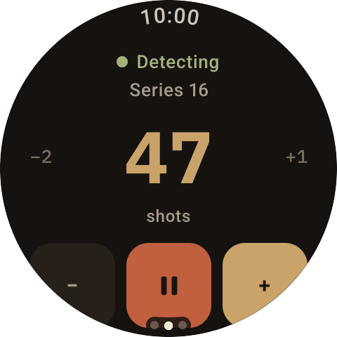
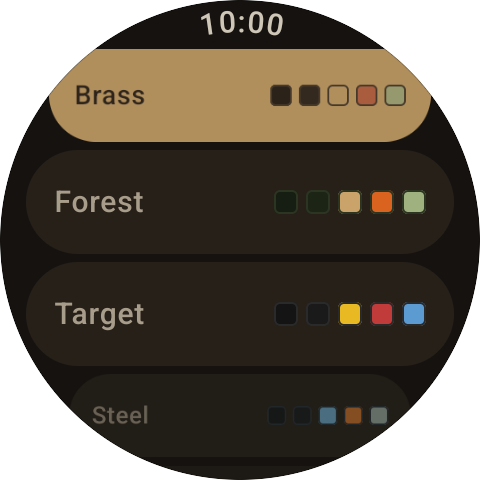
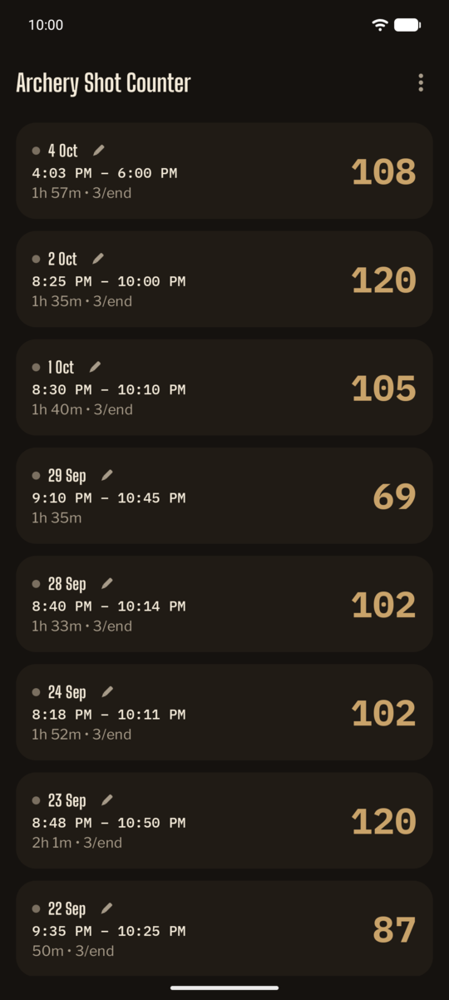
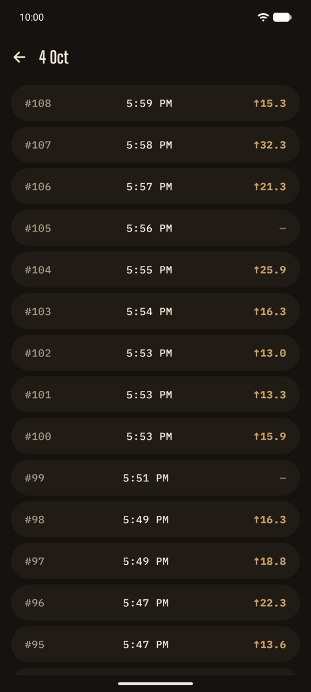
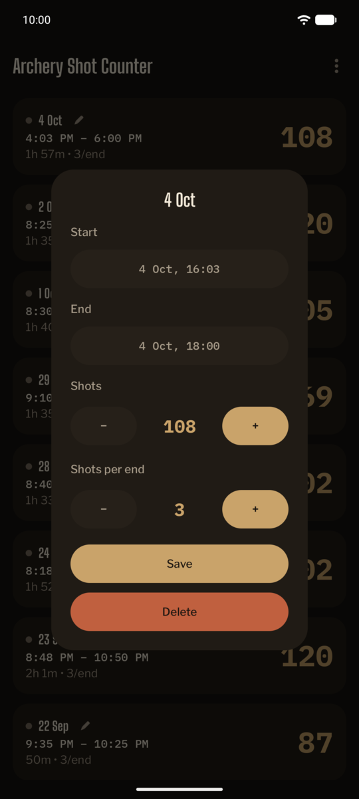
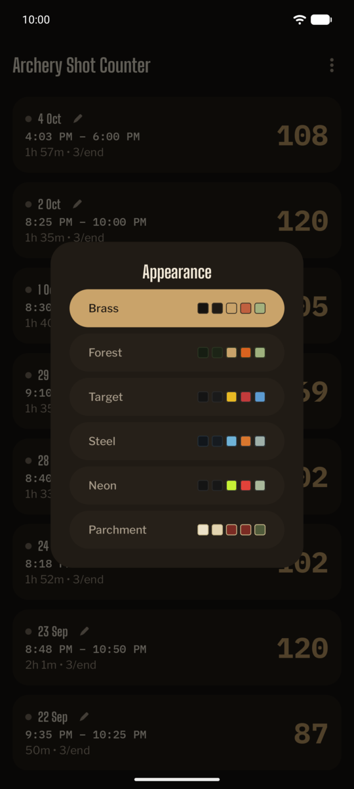

# Archery Shot Counter

**Automatic shot counting for archery training.**

Draw, release, and your watch counts the shot — no buttons, no hand tally, no breaking focus
mid-session. Later, review every session and every shot on your phone.

This is the umbrella repository: it describes the project as a whole and links to the
platform apps, each of which lives in its own repository.

## Platforms

| Platform | App | Repository | Status |
|---|---|---|---|
| Wear OS | Watch app — shot detection and session tracking | [ArcheryShotCounter-wearos](https://github.com/Vemestael/ArcheryShotCounter-wearos) | v1.6 · Google Play closed testing |
| Android | Phone companion — history, editing, backup | [ArcheryShotCounter-android](https://github.com/Vemestael/ArcheryShotCounter-android) | v1.6 · Google Play closed testing |
| watchOS | Apple Watch app | — | Planned |
| iOS | iPhone companion | — | Planned |

The watch app works on its own; the phone companion extends it and needs the watch app to
sync from. On Google Play both ship under a single listing.

## How it works

1. Start a session on the watch.
2. Shoot. When the string is released, the recoil produces a sharp spike in wrist
   acceleration; if it crosses your sensitivity threshold, the shot is counted and the watch
   vibrates.
3. Between ends, the watch can pause detection automatically, so walking to the target and
   pulling arrows isn't counted.
4. After training, review the session on the watch or on your phone: duration, shot count,
   and the time and impact strength of every shot.

Detection depends on the bow, which arm wears the watch and shooting technique — sensitivity
and the cooldown between shots are adjustable, and the count can always be corrected by hand.

## Features

- **Hands-free shot detection** from the wrist accelerometer, any bow style
- **Ends (series)** with progress on the counter and optional auto-pause between ends
- **Adjustable sensitivity** — presets or a custom threshold — and shot cooldown
- **Session history** with per-shot timestamps and impact strength
- **Session editing** on both watch and phone, kept in sync both ways
- **Export / import** — JSON or CSV backups from the phone companion
- **Six colour themes** and **12 interface languages**
- **Private by design** — no accounts, no servers; the watch app has no internet access at
  all, and data only moves between your own watch and phone — see the
  [privacy policy](https://vemestael.github.io/ArcheryShotCounter/privacy-policy.html)

Feature availability may differ between platforms — see each app's README for details.

## Screenshots

### Wear OS

   

### Android

   

## Contributing

Bug reports and suggestions are welcome. Issues specific to one app belong in that app's
repository; ideas about the product as a whole or new platforms can go here.

## License

The platform apps are MIT-licensed — see the LICENSE file in each repository.
